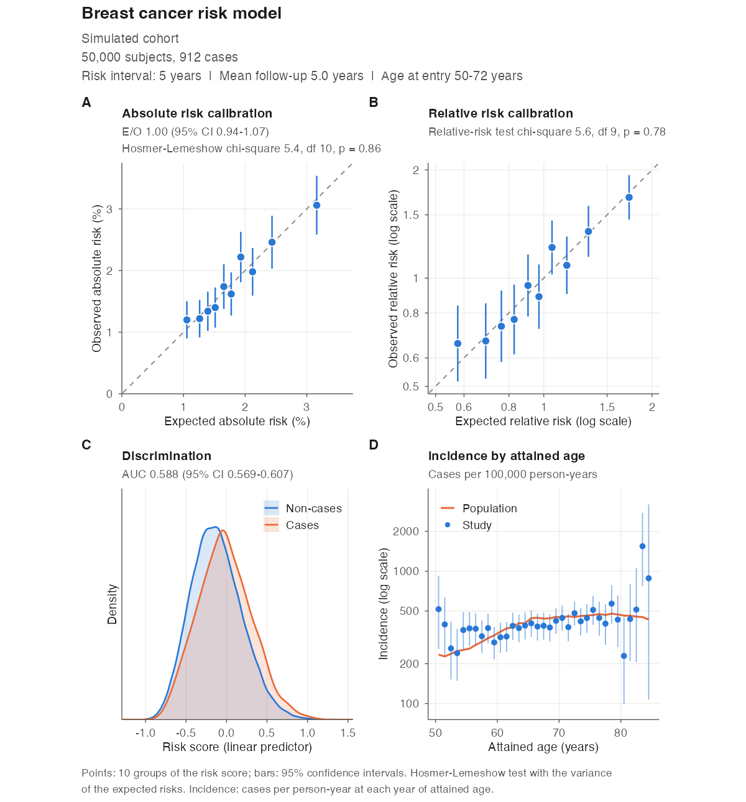

# iCARE: unofficial refactored distribution

<!-- badges: start -->
[](https://github.com/jeyabbalas/icare/actions/workflows/R-CMD-check.yaml)
[](https://jeyabbalas.github.io/icare/)
<!-- badges: end -->

> **This is not the official iCARE distribution.**
> The official R package iCARE is developed by its authors and distributed by
> **Bioconductor**: <https://bioconductor.org/packages/iCARE/>.
> Install it with `BiocManager::install("iCARE")`. Its source code is at
> [git.bioconductor.org/packages/iCARE](https://git.bioconductor.org/packages/iCARE)
> (mirrored at [github.com/bioc/iCARE](https://github.com/bioc/iCARE)), and its
> development repository is [github.com/parichoy/iCARE](https://github.com/parichoy/iCARE).
> Questions about the official package should go to its maintainers;
> questions about this distribution go to
> [this repository's issues](https://github.com/jeyabbalas/icare/issues).

iCARE (*Individualized Coherent Absolute Risk Estimation*; [Pal Choudhury et
al., 2020](https://doi.org/10.1371/journal.pone.0228198)) builds, applies and
validates models for the absolute risk of a disease. A model combines
relative risks of risk factors (classical risk factors and SNPs), a reference
sample representing the population, age-specific incidence rates of the
disease, and competing mortality rates. Risks are computed coherently for
people with missing risk factors, and models can be validated in cohort and
nested case-control studies.

## Purpose of this repository

This repository refactors iCARE from scratch, keeping its user-facing
interface (the same functions, arguments and result names) so that existing
scripts keep working. Its goals are

* **correctness**: every known defect of the official version is fixed (see
  [the differences](#differences-from-the-official-icare) below), including
  the fixes first made in iCARE 1.33.1.9002, a patched development version
  prepared by the maintainer of this distribution;
* **maintainability**: small, documented modules with descriptive names, and
  a test suite that checks each module against brute-force computations and
  recorded outputs of earlier versions;
* **speed without compiled code**: vectorized R that is faster than the
  official C code on every benchmark;
* **usability**: publication-ready figures and documentation for a wide
  audience.

## Installation

This distribution is installed from GitHub. It is pure R, so no compiler is
needed:

```r
# install.packages("remotes")
remotes::install_github("jeyabbalas/icare")
```

To build the vignettes too (slower):

```r
remotes::install_github("jeyabbalas/icare", build_vignettes = TRUE)
```

The package is named `iCARE`, like the official one, so installing it
replaces an official iCARE in the same library. To keep both, install this
one into a separate library and load it from there:

```r
dir.create("~/R/icare-unofficial", recursive = TRUE, showWarnings = FALSE)
remotes::install_github("jeyabbalas/icare", lib = "~/R/icare-unofficial")
library(iCARE, lib.loc = "~/R/icare-unofficial")
```

To return to the official version: `remove.packages("iCARE")`, then
`BiocManager::install("iCARE")`.

## Quick start

```r
library(iCARE)
data("bc_data", package = "iCARE")

# 30-year breast cancer risk from age 50 for three women
risks <- computeAbsoluteRisk(
  model.formula = bc_model_formula,
  model.cov.info = bc_model_cov_info,
  model.log.RR = bc_model_log_or,
  model.ref.dataset = ref_cov_dat,
  model.disease.incidence.rates = bc_inc,
  model.competing.incidence.rates = mort_inc,
  apply.age.start = 50,
  apply.age.interval.length = 30,
  apply.cov.profile = new_cov_prof
)
risks

# Validate 5-year risks in a cohort
cohort <- validation.cohort.data
validation <- ModelValidation(
  study.data = cohort,
  predicted.risk.interval = 5,
  iCARE.model.object = list(
    model.formula = bc_model_formula,
    model.cov.info = bc_model_cov_info,
    model.log.RR = bc_model_log_or,
    model.ref.dataset = ref_cov_dat,
    model.disease.incidence.rates = bc_inc,
    model.competing.incidence.rates = mort_inc,
    apply.cov.profile = cohort[, all.vars(bc_model_formula)[-1]]
  ),
  dataset = "Simulated cohort",
  model.name = "Breast cancer risk model"
)
validation                                            # report
plotModelValidation(validation.results = validation)  # figure
```

## Example figure

The last line of the quick start draws this figure, ready for publication:



* **A. Absolute risk calibration**: observed against expected risk in each
  decile of the risk score, with the E/O ratio and the Hosmer-Lemeshow test.
* **B. Relative risk calibration**: observed against expected relative
  risks, with the relative-risk test.
* **C. Discrimination**: the risk scores of cases and non-cases, with the
  AUC.
* **D. Incidence by attained age**: the study's incidence rates, with 95%
  confidence intervals, against the population rates of the model.

The panels are square, and the calibration panels use equal axes. The figure
is a [patchwork](https://patchwork.data-imaginist.com/) object, which can
be modified or saved with `ggplot2::ggsave()`. `panels` selects other
layouts, such as calibration next to the E/O ratio of each risk group (see
the [validation article](https://jeyabbalas.github.io/icare/articles/model-validation.html)).

## Documentation

The website <https://jeyabbalas.github.io/icare/> has the function reference
and four articles, also available as vignettes:

* [Getting started](https://jeyabbalas.github.io/icare/articles/iCARE.html):
  building a model, missing risk factors, SNPs, split intervals;
* [Validating an absolute risk model](https://jeyabbalas.github.io/icare/articles/model-validation.html):
  calibration, discrimination and the figures, with the statistical details;
* [Differences from the official iCARE](https://jeyabbalas.github.io/icare/articles/differences.html):
  each change, why it was made and its effect;
* [Performance](https://jeyabbalas.github.io/icare/articles/performance.html):
  timings against the official version.

## Differences from the official iCARE

The comparison is with Bioconductor iCARE 1.40.0. Changes marked † were
first made in 1.33.1.9002. The article
[Differences from the official iCARE](https://jeyabbalas.github.io/icare/articles/differences.html)
explains each one.

**Implementation**

* Pure, vectorized R. The C code and the `use.c.code` argument are removed
  (`use.c.code` is accepted with a deprecation warning and ignored).
* Faster than the official compiled code on every benchmark (see
  [Performance](#performance)).
* Dependencies: `ggplot2` and `patchwork` replace `plotrix`, `gtools` and
  `Hmisc`.
* `ModelValidation()` builds the model once for the study and the reference
  population.
* Invalid inputs stop with errors that name the argument and the problem;
  nothing is printed to the console.

**Absolute risks** (`computeAbsoluteRisk()`)

* The reference weights are used correctly in the calibration of the
  baseline hazard; the official version scrambled non-uniform weights. †
* Fractional start ages and interval lengths are used exactly (the official
  version rounded fractional starts up and counted any fraction of a year as
  a whole year).
* Only the years of age inside the intervals need rates. In the official
  version, a missing rate at the age where an interval ends (such as the
  example mortality rates from age 85) made the risks `NA` or, when intervals
  differed, silently replaced every profile's risk by its percentile-bin
  average; this also affected `ModelValidation()` when it computed the risks.
* Incidence and mortality rates given by age band (three columns) are read
  correctly (the official version divided each band's rate among its ages).
* A profile with missing risk factors keeps its own observed risk factors,
  completed with the donors' values of the missing ones, as in the published
  method. The official code averaged the donors' own risks, which can
  differ by more than 10% for profiles in the tails of the risk
  distribution.
* A profile with missing risk factors gets the risk over its own interval,
  independently of the other profiles. †
* With SNPs, the attenuation of the family-history log relative risk applies
  in any coding of family history.
* Columns of `apply.snp.profile` named after the SNPs are matched by name
  (the official version used their order).
* For SNP-only models, `refs.risk` holds the risks of simulated people, not
  averages over the `n.imp` sets of simulated people (which made the
  population distribution far too narrow).
* A single profile with a model of continuous covariates only works.
* Formulas that give infinite or undefined design values are rejected.
* The calibrated baseline hazard is returned (`attr(result, "calibration")`).
* `print()`, `summary()` and `plot()` methods.

**Split intervals** (`computeAbsoluteRiskSplitInterval()`)

* The risk is `AR1 + S1 * AR2`, with `S1` the probability of reaching the cut
  age alive and free of the disease; the official `AR1 + (1 - AR1) * AR2`
  ignores death from other causes before the cut age and overstates the
  risk.
* The reference weights are kept after the cut age, and `return.refs.risk`
  is passed through with a single model. †

**Model validation** (`ModelValidation()`)

* The AUC counts tied risk scores as 1/2 (the official version counted them
  as 0). †
* The AUC is computed in O(n log n) time and O(n) memory instead of building
  a cases × non-cases matrix.
* The Hosmer-Lemeshow statistic uses the variance under the null hypothesis
  by default, as the classical test does; `hosmer.lemeshow.variance =
  "observed"` gives the official statistic, which rejects calibrated models
  too often when groups have few cases.
* In sampled studies, the E/O confidence interval accounts for the
  variability of the expected risk and its covariance with the observed
  risk.
* Risk-score groups: tied scores form their own groups, no subject is left
  out, empty groups are dropped, duplicated or out-of-range cut-offs are
  ignored, and the degrees of freedom follow the number of groups formed. †
* A supplied `predicted.risk` or `linear.predictor` is never recomputed; the
  reference weights and `n.imp` in `iCARE.model.object` are used. †
* Onsets recorded after exit are censored at exit consistently, with a
  warning. †
* Cases diagnosed at exit are kept when ages have decimals; rounding error
  in exit minus entry made the official version drop many of them.
* The study incidence is the person-time rate by attained age, with
  confidence intervals, cases and person-years.
* Reference risks use each reference row's own window, and, with SNPs, each
  row's own risk score.
* `Category_Results` is numeric and adds each group's E/O with its
  confidence interval and the numbers of subjects and cases;
  `Category_Specific_Expected_to_Observed_Ratio` is new.
* Clear checks: an error without a validation interval, cases need a finite
  onset (non-cases may have `Inf` or `NA`), unknown names in
  `iCARE.model.object` are reported; `use.c.code`, `return.lp` and
  `return.refs.risk` in the model object are ignored.
* Precise small p-values, and descriptive labels in the test results.

**Figures** (`plotModelValidation()`)

* Redrawn with ggplot2: square panels with equal axes for calibration, each
  panel showing its statistics, incidence by attained age for the study and
  the population, and an optional panel of E/O by risk group.
* Returns the figure, to modify or save with `ggplot2::ggsave()`.
  `risk.score.plot.percent.smooth` is accepted and ignored.

## Performance

Median elapsed time (seconds) on an Apple M5 Pro with R 4.6.2:

| Workload | This distribution | Official 1.40.0, C code | Official 1.40.0, R code | 1.33.1.9002, C code | Speed-up vs official C |
|:--|--:|--:|--:|--:|--:|
| Risks, 10,000 complete profiles | 0.17 | 13.2 | 51.4 | 13.8 | 79.9× |
| Risks, 2,000 profiles with missing covariates | 0.94 | 2.97 | 7.63 | 3.06 | 3.2× |
| Risks with 72 SNPs, 1,000 profiles with missing genotypes | 7.43 | 12.2 | 28.1 | 11.6 | 1.6× |
| Split-interval risks, 2,000 profiles | 0.22 | 0.51 | 0.48 | 0.51 | 2.3× |
| Validation, full cohort (49,767), risks supplied | 0.048 | 0.96 | 0.82 | 1.18 | 20.0× |
| Validation, nested case-control (5,240), risks supplied | 0.010 | 0.21 | 0.21 | 0.22 | 20.9× |
| Validation, 10,000 subjects, risks computed | 0.17 | 0.39 | 0.38 | 0.40 | 2.3× |

Timings come from
[`tools/benchmarks`](https://github.com/jeyabbalas/icare/tree/main/tools/benchmarks);
see the [Performance article](https://jeyabbalas.github.io/icare/articles/performance.html).

## Testing

The test suite (testthat) checks each module against direct
implementations of its definition, for example risks against the defining
sum year by year, missing-data risks against an explicit average over donors,
and the AUC against a pairwise count, and checks the results against
recorded outputs of the official version 1.40.0 and of 1.33.1.9002 where
those are correct. Run it with `devtools::test()`.

A simulation study,
[`tools/simulations/validation-simulation.R`](https://github.com/jeyabbalas/icare/tree/main/tools/simulations),
checks that the confidence intervals of `ModelValidation()` have their
nominal coverage and that its tests have their nominal size. The results
are in the
[validation article](https://jeyabbalas.github.io/icare/articles/model-validation.html#how-well-the-intervals-and-tests-work).

## Citation

Please cite the article describing iCARE:

> Pal Choudhury P, Maas P, Wilcox A, Wheeler W, Brook M, Check D,
> Garcia-Closas M, Chatterjee N (2020). iCARE: An R package to build,
> validate and apply absolute risk models. *PLoS ONE* 15(2): e0228198.
> <https://doi.org/10.1371/journal.pone.0228198>

and state that you used this distribution, with its version
(`citation("iCARE")`).

## License and authors

iCARE was written by Parichoy Pal Choudhury, Paige Maas, William Wheeler and
Nilanjan Chatterjee. This distribution is maintained by Jeya Balaji
Balasubramanian. It is distributed under the GPL-3 with the license agreement
of the official package (see `LICENSE`), which states that the software is not
intended for treating or diagnosing human subjects.
